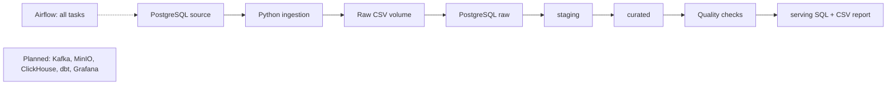

# Bank Data Platform — Phase 1

A daily batch pipeline for synthetic bank transactions. It reads from
PostgreSQL, saves raw CSV files, loads warehouse layers and produces a daily
summary for an operations analyst.

| Tool | Role |
|---|---|
| Python | Sample data, CSV files and quality checks |
| PostgreSQL | Source and warehouse schemas |
| Airflow | Task dependencies, retries, schedule and run status |
| Docker Compose | Local services and persistent volumes |
| GitHub Actions | Lint, format, compile and Compose checks |



The connected stages are implemented. Planned tools are outside the current
pipeline. See [ADR-0002](docs/decisions/0002-minimal-phase-1.md).

## Run the pipeline

Install Docker Desktop with Compose v2, Git and Make. Local Python is not
required. Default host ports are 5434 for PostgreSQL and 8086 for Airflow.
Connection settings and schema names are in `.env`. Example passwords are
for local use only.

```bash
cp .env.example .env
make up
make run DATE=2026-01-15
make report DATE=2026-01-15
make smoke
```

The first startup downloads and builds the images. `make run` uses Airflow's
`dags test` command to run the tasks and save their status in the metadata
database. Expected result: a successful DAG, 1200 rows in each detail layer
and one serving row for AZN with 1200 transactions, 120 declines and a total
amount of 120600.

Airflow UI: http://localhost:8086. The example login is `admin` /
`local_course_only`, configured by `AIRFLOW_ADMIN_USER` and
`AIRFLOW_ADMIN_PASSWORD`. To reset the password on an existing volume:

```bash
docker compose exec airflow bash -c 'airflow users reset-password --username "$AIRFLOW_ADMIN_USER" --password "$AIRFLOW_ADMIN_PASSWORD"'
```

The DAG has a daily schedule and starts paused. Enable it in the UI or use:

```bash
docker compose exec airflow airflow dags unpause bank_batch
docker compose exec airflow airflow dags trigger bank_batch --exec-date 2026-01-20T00:00:00+00:00
```

Use `make run` for a specific test date. Logical dates use UTC. Do not start
CLI tests and scheduled runs for the same date at the same time. Scheduled
runs are limited to one active run.

## Check each layer

```bash
make verify DATE=2026-01-15
make report DATE=2026-01-15
docker compose exec airflow bash -c 'head -3 "$RAW_DIR/ds=2026-01-15/transactions.csv"'
docker compose exec source-db sh -c 'psql -U "$POSTGRES_USER" -d "$POSTGRES_DB"'
```

Inside psql, using the default schema names:

```sql
SELECT count(*) FROM public.batch_transactions WHERE txn_date='2026-01-15';
SELECT count(*) FROM raw.transactions WHERE txn_date='2026-01-15';
SELECT count(*) FROM staging.transactions WHERE txn_date='2026-01-15';
SELECT count(*) FROM curated.transactions WHERE txn_date='2026-01-15';
SELECT * FROM serving.daily_summary WHERE txn_date='2026-01-15';
```

The analyst can use the last query or the CSV output from `make report`.
The saved query is in `serving/daily_summary.sql`. Update its schema name if
you change `SERVING_SCHEMA` in `.env`.

Serving data is grouped by date and currency, so its row count is lower than
the detail tables. The smoke test compares its transaction_count with the
number of detail rows.

## Failure and retry tests

```bash
make failure DATE=2026-01-17
make quality-failure DATE=2026-01-18
```

These deliberately fail ingestion and quality checks. Tasks retry once after
10 seconds. The run should be failed, with downstream tasks marked
upstream_failed. Check the run status in Airflow as well as the CLI output.
Run the same date again without the failure flag to recover.

Quality checks cover non-empty data, non-null keys, unique keys and positive
amounts. A failed check stops publishing. An existing report from an earlier
successful run is kept, so check the current DAG status before using it.

## Repeat and restart tests

```bash
make run DATE=2026-01-15
make run DATE=2026-01-15
make run DATE=2026-01-16
make down
make up
make verify DATE=2026-01-15
make verify DATE=2026-01-16
make run DATE=2026-01-15
```

CSV files are replaced at the same date-specific path. Database layers delete
and insert only the selected date within a transaction. Other dates are kept.
`docker compose down` preserves the volumes; `down -v` deletes them.

## Files and logs

- `orchestration/bank_batch.py`: prepare → ingest → load → transform → quality → publish.
- `pipeline/tasks.py`: the functions used by each task.
- `tests/smoke.py`: runs one date twice and another date once, checks all layers
  and reports row counts and DAG status.
- `docker-compose.yml`: services and persistent volumes.
- `ingestion/generator/` and `infra/debezium/`: older streaming prototype files,
  not used by the Phase 1 pipeline.

Logs are available through `make logs` or Airflow UI → bank_batch → run → task
→ Logs. Tasks log start, end, input, output and row counts. Failed tasks show
a traceback and failed status.

The generator uses fixed IDs per day and skips existing source rows. Staging
trims merchant names and removes duplicate rows. Curated is a simple detail
table. Source and warehouse share one PostgreSQL instance for this local setup.

Possible Phase 2 work: a real source, fact and dimension tables, currency
conversion and separate storage services.

CI runs static checks on pushes and pull requests. The smoke test uses local
Docker services. See [test results](docs/evidence/phase-1.md) for screenshots,
row counts and remaining submission steps.
