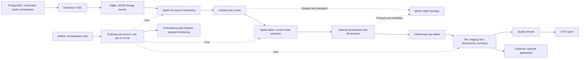

# Bank Data Platform

A local end-to-end data engineering project for customer records, issued cards
and card transactions. PostgreSQL changes pass through Debezium, Kafka and
Spark into an Iceberg lakehouse and a ClickHouse warehouse. Airflow coordinates
the work; it does not process the data itself.

## Architecture



Iceberg uses a JDBC catalog in PostgreSQL. MinIO is storage, Parquet is a file
format, and Iceberg manages table metadata and snapshots. They have different
roles and do not require three storage servers.

## Requirements

- Docker Desktop with Compose v2, Git and Make.
- A 16 GB laptop. Start with at least 8 GB allocated to Docker and enough free
  disk space for images and data. Close unrelated containers if memory is tight.
- Internet access on the first build. MinIO is built from its pinned upstream
  source because historical image registries may be unavailable. Spark JARs are downloaded into the image,
  not fetched each time a DAG runs.

The core uses eight running services, a one-shot Kafka topic initializer and
one active Spark JVM. BI and monitoring are
optional profiles. This is a single-user demo, not a production deployment.

## Quick start

```bash
cp .env.example .env
make                 # same as make help
make up              # build, start, create source/bucket and register CDC
make run DATE=2026-01-15
make verify DATE=2026-01-15
make report DATE=2026-01-15
```

The first build can take several minutes. `make up` waits for services and
registers the connector automatically. The v2 stack uses new volumes; older
Phase 1 database volumes are not migrated or deleted. If you previously started
an older Compose version, stop its containers before starting v2 to free ports.

`make run` executes the real DAG with `airflow dags test` and checks the saved
run state. Every processing step is submitted to the external worker, including
when the DAG is run this way. The scheduler can also run the same DAG.

Expected initial result per date: 100 customers, 200 cards, 1200 transactions,
120 declines, total amount 120600 AZN. All amounts are synthetic. There is no
real card number or personal data.

## Interfaces

| Service | Address | Credentials from .env |
|---|---|---|
| Airflow | http://localhost:8086 | AIRFLOW_ADMIN_USER / AIRFLOW_ADMIN_PASSWORD |
| Kafbat | http://localhost:8085 | Local access |
| MinIO console | http://localhost:9001 | MINIO_ROOT_USER / MINIO_ROOT_PASSWORD |
| PostgreSQL | localhost:5434 | SOURCE_DB_NAME / SOURCE_DB_USER / SOURCE_DB_PASSWORD |
| ClickHouse HTTP / DBeaver | localhost:8123 | CLICKHOUSE_DB / CLICKHOUSE_USER / CLICKHOUSE_PASSWORD |
| Superset, after make bi | http://localhost:8088 | SUPERSET_ADMIN_USER / SUPERSET_ADMIN_PASSWORD |
| Grafana, after make monitoring | http://localhost:3000 | GRAFANA_ADMIN_USER / GRAFANA_ADMIN_PASSWORD |
| Prometheus | http://localhost:9090 | Local access |

Example credentials are for local use. Change them before sharing a running
instance. Only host UI/database ports are published, bound to 127.0.0.1.
The worker's job API is internal and uses a token. `.env` is ignored by Git.
Do not commit generated reports, logs, data files or local credentials.
Changing a PostgreSQL password in `.env` does not change an existing volume's
password; update the database role or start a fresh demo volume deliberately.

## Airflow and Spark separation

Open `bank_pipeline` → Code. The DAG contains only BashOperator definitions
and task dependencies. No source queries, Spark sessions or business logic
run during DAG parsing. The worker receives an allowlisted stage name, runs
`spark-submit` or a Python/dbt subprocess and saves the result and logs.
Airflow polls the result and fails its task when the external process fails.
Neither service mounts the Docker socket.

Tasks: seed_source → ingest_cdc → transform_lake → load_warehouse → dbt_models
→ quality_checks → publish_report. Each has one retry with a 15-second delay.
The daily schedule is paused by default; max_active_runs=1. To enable it:

```bash
docker compose exec airflow airflow dags unpause bank_pipeline
```

For a scheduler-triggered manual run, use the UI or CLI. Do not run `make run`
and a scheduled run for the same date simultaneously.

```bash
docker compose exec airflow airflow dags trigger bank_pipeline --exec-date 2026-01-20T00:00:00+00:00
```

## Demonstrate CDC

```bash
make cdc-demo DATE=2026-01-15
```

This changes the first transaction amount to 999 and inserts a transaction
with merchant `CDC demo` and amount 25. The same pipeline then runs and verifies
the source, lake and warehouse. Expected: 1201 transactions and total amount
121623 AZN. Repeating this command does not add another demo row.

Debezium reads the initial table snapshot and later WAL changes. Spark uses a
checkpoint and available-now microbatches: it consumes available records and
exits. The connector remains running. This is the bounded batch mode. The optional continuous mode below keeps Spark
running and publishes microbatches automatically.

## Tests and recovery

```bash
make smoke                         # repeat date, second date, all real layers
make failure DATE=2026-01-17        # expected failed DAG, blocked downstream
make quality-failure DATE=2026-01-18
make run DATE=2026-01-17            # recover without the failure flag
make run DATE=2026-01-18
make down                          # preserve all volumes
make up
make verify DATE=2026-01-15
```

Failure commands return successfully only when the expected failed DAG state
and blocked publish task are observed. Check the red tasks in Airflow.
A stopped worker marks interrupted jobs failed after restart; rerun the DAG.
For transient failures, inspect logs and retry rather than deleting checkpoints.

Raw events deduplicate by topic/partition/offset. Spark reconstructs the latest
row by key and applies deletes. Iceberg overwrites the selected date. ClickHouse
loads into a temporary partition and atomically replaces that date. dbt rebuilds
marts from all loaded dates. Verify compares counts, amounts, transaction IDs,
a known updated row and the CSV report. Raw event counts include CDC history,
dimensions and run barriers, so they are not equal to transaction row counts.

A source barrier confirms that ingestion caught up rather than relying on a
fixed sleep. There is no cross-system distributed transaction: use successful
Airflow runs as the publication signal. See [design limits](docs/decisions/0003-cdc-lakehouse.md).

## SQL and dashboards

Create two DBeaver connections: PostgreSQL for source tables and ClickHouse for
analytics. Use the settings above and passwords from `.env`. The ClickHouse
JDBC driver uses HTTP port 8123, not the native server port 9002.
[serving/demo.sql](serving/demo.sql) labels the queries for each connection.
Do not execute the entire file on one database engine.

```bash
make bi              # run after the first successful pipeline
make monitoring
```

Superset provisions a ClickHouse connection, a daily_summary dataset and a
Bank Overview dashboard. Open Dashboards → Bank Overview, or use SQL Lab.
Grafana provisions a Bank Pipeline Jobs dashboard backed by Prometheus.
To save RAM, stop the optional services while running larger jobs:

```bash
docker compose stop superset grafana prometheus
```

## Commands and files

`make help` lists all commands. `make logs` shows Airflow logs. `make worker-logs`
shows HTTP job requests; full subprocess logs live in `/state/jobs` in the worker
and their last 24 KB are included in Airflow task logs.

| Path | Purpose |
|---|---|
| orchestration/ | Lightweight DAG |
| scripts/job_client.py | Submit and poll jobs; no processing imports |
| worker/ | Single-job runner and separate Spark image |
| jobs/ | Source, CDC ingestion, Spark transformations, load and verification |
| transformation/ | dbt sources, models, tests and generated lineage |
| infra/monitoring/ | Prometheus and Grafana provisioning |
| infra/superset/ | Superset image and automatic dashboard setup |
| serving/ | SQL demonstrations |

Source generation and connector registration are in `jobs/source.py` and
`jobs/setup.py`. Earlier batch-only code remains in Git history.

CI runs lint, formatting, compilation, unit checks and Compose validation on
pushes and pull requests. Full integration tests run against real local services.
See [validation evidence](docs/evidence/current.md).

## Clean up

`make down` stops all profiles and preserves data. To delete the v2 database,
Kafka log, lake, checkpoints, reports and dashboard state deliberately:

```bash
make clean CONFIRM=yes
```

This does not delete unrelated Docker projects or old Phase 1 named volumes.
The image cache remains, so the next build can reuse downloaded dependencies.

## Inspect live CDC with Kafbat

Kafbat starts with the core services and is available at http://localhost:8085
(default KAFBAT_HOST_PORT). It connects to the real Kafka broker and Debezium
Connect service automatically. Open cluster `bank`, then Topics, then
`bank_v2.bank.transactions` → Messages. The names follow CDC_TOPIC_PREFIX and
BANK_SCHEMA from .env. Kafka Connect shows the running PostgreSQL connector.

```bash
make kafbat
make run DATE=2026-01-22
make cdc-source DATE=2026-01-22
make live DATE=2026-01-22 DURATION=30 RATE=1
# Wait for live traffic to finish, then update the lake and reports:
make run DATE=2026-01-22
make verify DATE=2026-01-22
```

`cdc-source` changes only PostgreSQL; it does not run Spark. `live` generates
bounded PostgreSQL inserts, updates and deletes, so Kafbat can show actual CDC
messages as they arrive. Debezium publishes the Kafka events. These are synthetic
bank records travelling through real services, not real customer data.
In each JSON value, inspect op (c/u/d), before, after, source.lsn and the Kafka
offset. Snapshot records use op=r. Kafka history includes deleted and updated
versions; it is different from the current-state warehouse.

Do not run reconciliation while the generator is still changing the source.
The connector remains live. Batch mode uses available-now triggers; continuous
mode is enabled explicitly with make realtime-start. Kafbat only observes Kafka.
The live generator reserves separate IDs and never deletes seeded transactions.
It updates the first seeded amount and deletes only its own `Live demo` rows.
Each cycle inserts and updates; every third cycle also deletes the previous
live row. RATE is cycles per second, not the number of Kafka messages per second.

## UTC timestamps and continuous processing

Rows now carry these separate milestones through Iceberg, ClickHouse and dbt:

| Column | Meaning |
|---|---|
| txn_time | Business event time; can be historical |
| source_changed_at | Source change/commit time reported by Debezium |
| cdc_emitted_at | Debezium envelope processing time |
| kafka_timestamp | Kafka record timestamp; inspect kafka_timestamp_type |
| ingested_at | First persisted Spark ingestion observation with this instrumentation |
| processed_at | Transform computation evaluated, before Iceberg commit |
| loaded_at | ClickHouse server insertion time, before partition publication |

All these instants use UTC. Warehouse observations use DateTime64(3).
New Kafka business records use broker LogAppendTime (type 1); historical type 0
records retain producer CreateTime. PostgreSQL source rows also have created_at
and updated_at; old source rows are not assigned invented historical dates.
Topic/partition/offset, source LSN and CDC operation accompany the timings.

```bash
make up
# DATE defaults to today's UTC date. An explicit date is still supported.
make run
make verify
make timings
make realtime-start
make realtime-status
# Wait for last_completed_at / phase=waiting before the live demonstration.
make live DURATION=30 RATE=1
# No make run is needed: the continuous process updates the downstream data.
make timings
make realtime-status
# Let the producer finish and the last microbatch complete before stopping.
make realtime-stop
make verify
```

Continuous mode uses a long-lived Spark session and processing-time microbatches
(default 10-second target, REALTIME_INTERVAL_SECONDS). It automatically runs
transformation, warehouse load, dbt checks and CSV publication after input
arrives. The first history replay can take much longer than one trigger interval.
A trigger interval is not a guaranteed end-to-end latency. `make realtime-logs`
shows the external Spark process output. Startup acceptance is not readiness;
check status and a completed microbatch before demonstrating arrivals.

Only one writer may run: stop realtime before make run, make verify, make smoke
or other worker jobs. A conflicting batch request fails with a clear message.
`make timings` reads SQL directly and can be used while realtime is active.
Airflow is still the batch orchestrator; its DAG does not process streaming data.

For today's UTC date, the live generator stamps new transaction events with the
actual current UTC clock. An explicit older date remains a historical/backfill
example. The seed is a deterministic daily fixture, not real customer activity.

After a graceful stop, `make realtime-start` resumes the persistent checkpoint.
If the worker is killed/restarted mid-batch, inspect status/logs and restart the
process explicitly. The raw merge and partition replacement tolerate replay.
Reports and marts are eventually consistent across services, not one distributed
transaction. Source reconciliation must run after the producer has stopped.

Schema changes are additive and do not require make clean. Replayed raw records
can fill missing observations if Kafka still retains them. Unrecorded historical
times remain NULL until genuinely reprocessed; an instrumented replay time is
not the original historical ingestion time. Rerun a date before strict timing
verification of an old partition. See [ADR-0004](docs/decisions/0004-timestamps-and-continuous-processing.md).

In DBeaver use [serving/timings.sql](serving/timings.sql) to inspect UTC milestones
and measured delays. Do not use historical txn_time to calculate transport lag;
source_changed_at is the appropriate starting milestone. For clock skew or
historical missing metadata, investigate the observation instead of inventing
or clamping latency values. Superset summaries include latest source/load times;
refresh the chart to see updates. Grafana includes continuous-process status,
last microbatch age and row count.

The source_to_current_load_ms query measures elapsed time to the latest load
attempt. Rebuilding a partition refreshes processing/load times even for
unchanged transaction versions, so old rows can show large elapsed values.
Measure newly arriving CDC versions at their first publication for a latency
demonstration; do not interpret historical replay age as current stream lag.
