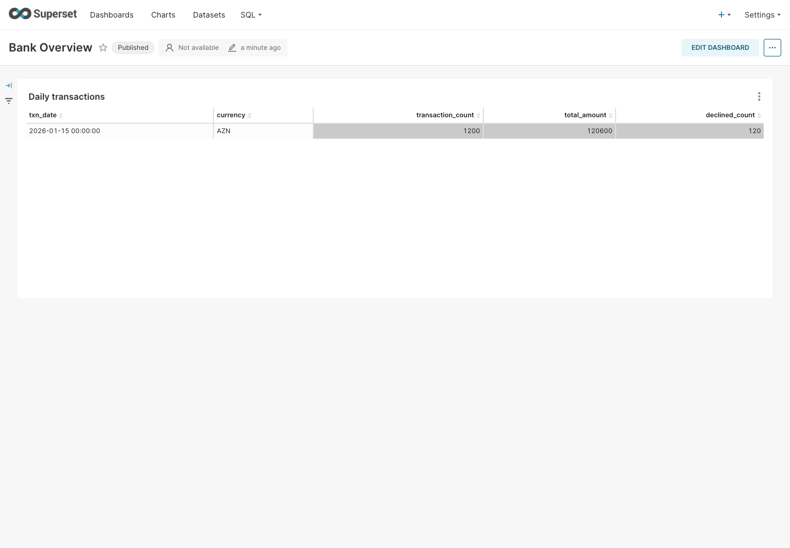
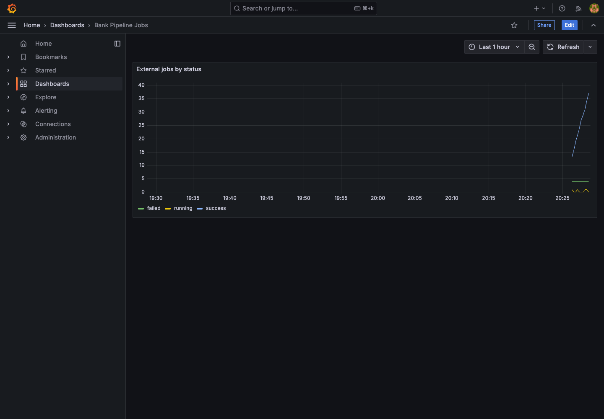
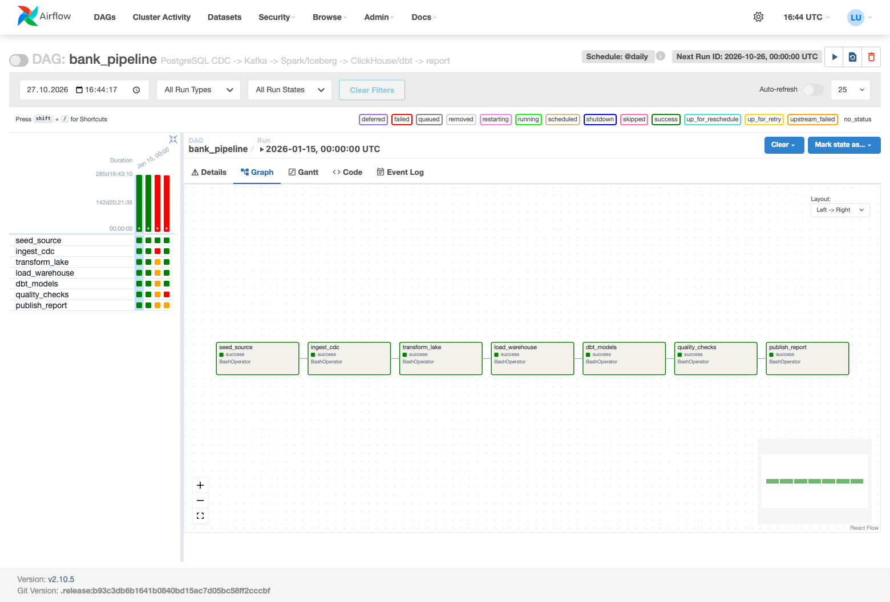
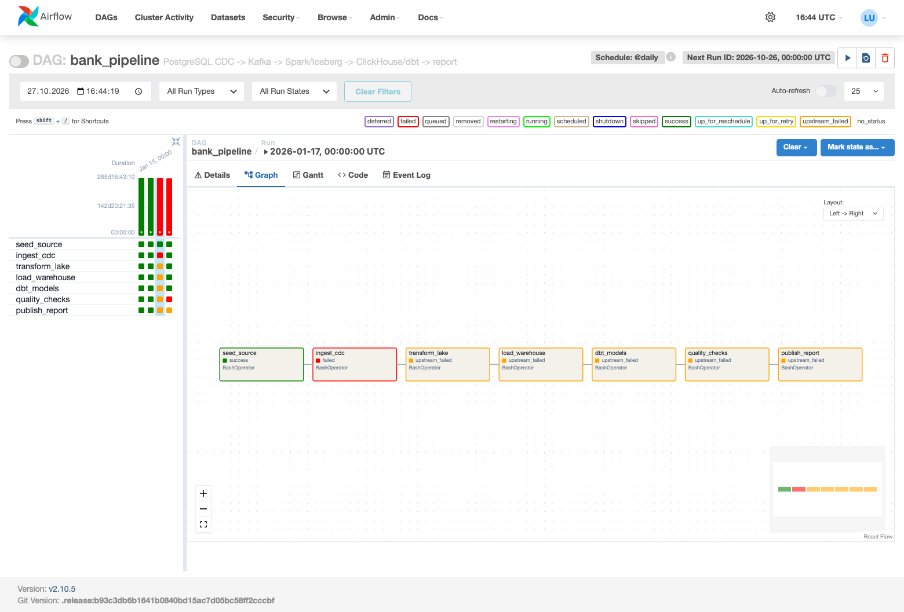
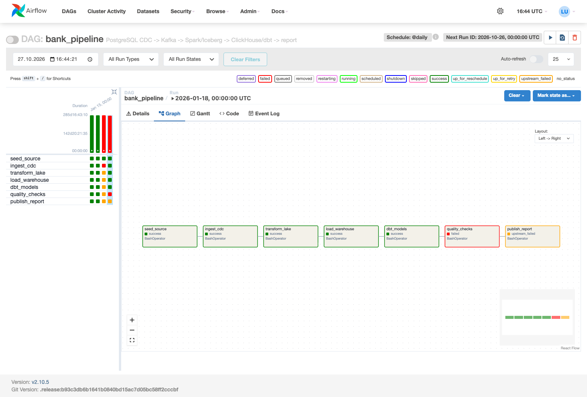
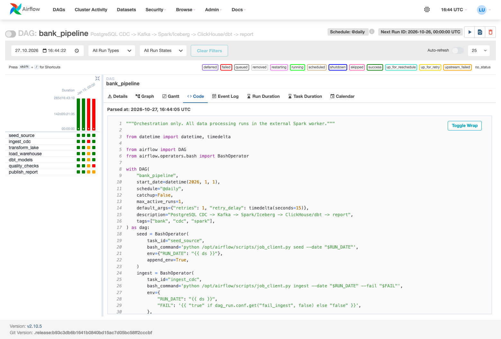

# Current pipeline validation

Date: 2026-10-27. Local Apple Silicon machine, 16 GB RAM, Docker VM approximately
8 GB. Tests use real PostgreSQL, Debezium, Kafka, MinIO, Spark, Iceberg and
ClickHouse services. Earlier Phase 1 screenshots describe the old batch-only
implementation and are not evidence for the current pipeline.

## Pipeline and reconciliation

The Airflow DAG completed all seven tasks successfully. Six dbt models built
and 11 dbt tests passed. The quality gate also checked source reconciliation.

| Test | Source transactions | Iceberg | ClickHouse raw | Staging | Fact | Serving transactions | CSV transactions |
|---|---:|---:|---:|---:|---:|---:|---:|
| 2026-01-15, initial | 1200 | 1200 | 1200 | 1200 | 1200 | 1200 | 1200 |
| 2026-01-15, repeated | 1200 | 1200 | 1200 | 1200 | 1200 | 1200 | 1200 |
| 2026-01-16 | 1200 | 1200 | 1200 | 1200 | 1200 | 1200 | 1200 |
| 2026-01-15, CDC update + insert | 1201 | 1201 | 1201 | 1201 | 1201 | 1201 | 1201 |
| 2026-01-15, delete demo row | 1200 | 1200 | 1200 | 1200 | 1200 | 1200 | 1200 |

Dimensions contain 100 customers and 200 cards. Initial raw_events count was
1503, including dimensions and technical markers. Raw events are unique by
(topic, partition, offset). History and markers make the event count larger than
the number of current business rows; each new run can add a barrier event.

Verification compared counts, sums of amounts, sums of IDs, a known updated row
and the exported CSV. It also checked for real Parquet and Iceberg metadata
objects in MinIO. The amount changed from 1.00 to 999.00. The added demo row had
amount 25.00. After the insert/update, the total was 121623.00 AZN.

`make smoke` finished with:

```
SMOKE PASSED: all layers, repeat, two dates, real Airflow runs
```

The delete test removed only the synthetic CDC demo row from PostgreSQL, reran
the DAG and verified all layers at 1200 rows. The updated first amount remained
999.00, proving that updates and deletes were handled independently.

## Expected failures

- 2026-01-17: fail_ingest=true. ingest_cdc failed after retry;
  transform_lake through publish_report became upstream_failed.
- 2026-01-18: fail_quality=true. Earlier tasks passed; quality_checks failed
  after retry and publish_report became upstream_failed.
- The CLI checked the actual Airflow metadata state and asserted the blocked
  publish status. These are expected failure demonstrations.

## Resource correction

UI testing exposed an OOM in the first Airflow standalone setup. The current
configuration starts only scheduler and webserver, skips the separate log
server/triggerer and allows 2 GB for Airflow. With a pipeline run and browser
navigation together, the new container reported oom=0 and oom_kill=0; scheduler
and metadata database were healthy. Spark remained in a different container.

## Dashboards

Superset was provisioned automatically and tested through a real browser login.
The daily table showed 1200 transactions, 120600 total amount and 120 declines
before the CDC update. Prometheus reported the worker target as up and returned
job metrics. Grafana's provisioned dashboard was opened in a real browser.





## Static checks

Ruff lint and formatting, compile checks, three unit checks for external job
execution/DAG boundaries, Bash syntax checks and Compose configuration validation
passed. `.env`, generated data, dbt artifacts, logs and local environments are
ignored; `.env.example` remains eligible for Git.

## Remaining remote steps

GitHub CI execution, branch protection, pull requests and release tags depend
on the remote repository workflow. They have not been claimed as completed by
these local tests.

## Clean setup and restart

A separate `bank-v2-fresh` Compose project was started from `.env.example` with
new volumes. Automatic setup, CDC registration, the full DAG for 2026-01-19 and
all-layer verification passed at 1200 rows. No manual file copying, connector
UI clicks or volume permission changes were required. A startup status race
was fixed: Connect can briefly return 404 after accepting a new connector;
setup now waits for the actual running task state.

The temporary test project was then removed. The original project was brought
back using its existing volumes. Verification confirmed both 2026-01-15 and
2026-01-16 results, including the edited amount 999.00 on the first date.
This checked PostgreSQL, Kafka/Connect state, MinIO, Iceberg catalog, ClickHouse,
checkpoints, reports and Airflow metadata across a complete down/up cycle.

Finally, the synthetic first amount was restored to 1.00 and the DAG was run
again. All layers and the CSV now show the starting demonstration values:
1200 transactions, 120600.00 total amount, 120 declines. Optional dashboards
were restarted successfully. Earlier CDC test results above remain test history,
not a description of the final reset sample values.

## Current Airflow screenshots

Successful run:



Deliberate ingestion failure:



Deliberate quality failure:



Code view contains operator definitions and dependencies, without processing functions:



## Kafbat live CDC validation — 2026-10-28

Kafbat v1.5.0 reported cluster bank ONLINE and exposed the real Debezium connector.
In a real browser, the transaction Messages page was switched from Newest to
Live (TAILING). A six-second source generator run for 2026-01-23 produced six
inserts, six updates and two deletes, all observed in the live UI. The generator
wrote only to PostgreSQL; Debezium emitted the Kafka events.

After the generator stopped, the real Airflow DAG succeeded and verification
reported 1204 transactions in source, Iceberg, ClickHouse raw/staging/fact,
serving and CSV. The first transaction amount was 7.00. This validates visible
CDC events as well as their application downstream.

## UTC instrumentation and continuous processing — 2026-10-30 (Asia/Baku)

Corresponding UTC logs are on the evening of 2026-10-29. Business logical dates
and wall-clock observation dates are intentionally separate.

The new instrumented batch succeeded for 2026-01-30: all 1200 fact rows had CDC,
Kafka, ingestion, transformation and warehouse timestamps; required timing
checks passed and processing/load order had no negative delays. PostgreSQL
source audit fields were added without inventing old row creation times.

A long-lived Spark Structured Streaming process was started through the worker.
With no intervening Airflow batch run, an eight-cycle source generator changed
the materialized result from 1200 rows / 120600.00 AZN to 1206 / 120637.00 AZN.
Continuous reads of the fact table reported no query errors during this test.
The retained live records had Kafka timestampType=1 (LogAppendTime) and ordered
source, CDC, Kafka, ingestion, processing and warehouse timestamps.

Measured source-to-warehouse-insertion elapsed times for six surviving rows were
12467, 10455, 9452, 7446, 6442 and 5440 ms. This is a local observation, not an SLA
or a measurement of browser rendering/CSV completion. One example in UTC:

| Milestone | Value |
|---|---|
| source_changed_at | 2026-10-29 21:04:27.974 |
| cdc_emitted_at | 2026-10-29 21:04:28.347 |
| kafka_timestamp | 2026-10-29 21:04:28.362 |
| ingested_at | 2026-10-29 21:04:30.008 |
| processed_at | 2026-10-29 21:04:32.982 |
| loaded_at | 2026-10-29 21:04:33.414 |

Graceful stop succeeded, followed by strict source/lake/warehouse/report
reconciliation at 1206 rows. Continuous mode then resumed its persistent
checkpoint at the next batch (batch 2, 1201 new records), rather than resetting
its history. A second three-cycle test used today's UTC event date: new live
transactions used the actual current event clock. The result converged from
1200 / 120600.00 to 1202 / 120607.00 without a batch command. Strict verification
after stop passed.

Additional actual-service boundary tests:

- A batch writer POST while realtime owned the writer returned HTTP 409.
- A synthetic one-row transaction date moved from 2026-02-01 to 2026-02-02;
  the old date cleared and the new date appeared automatically.
- Deleting the final row cleared the new partition and serving summary;
  both empty dates passed source reconciliation and their CSV files contained
  only headers, with no stale previous result.
- A temporary legacy ClickHouse table retained NULL for old unrecorded load
  times after migration. A new insert received server now64() time. The temporary
  database was removed after the assertion.
- The full repeat/two-date smoke test passed with instrumented timestamps.
  A separate before/after comparison confirmed that the same source offset kept
  ingested_at=2026-10-29 21:11:10.013 across reruns, while processed_at and loaded_at
  advanced to the new processing attempt. Business row counts remained stable.

There are now 12 dbt tests, including the processing-time chain test. Static CI
also exercises real local HTTP writer exclusion with no Spark process in the
DAG. Continuous mode remains near-real-time microbatch processing, with explicit
startup/readiness, stop and checkpoint controls, not global exactly-once or a
fixed sub-second latency guarantee.

The deliberate failure assertions now also require the intended failing task:
ingest_cdc for fail_ingest, and quality_checks after successful dbt_models for
fail_quality. Both scenarios passed with the timestamp instrumentation; an
unrelated writer/setup failure cannot count as the deliberate failure proof.
The Superset timing columns and the three new Grafana process panels were
validated in real browser sessions. Grafana's default-password welcome prompt
was skipped for the local demonstration; no password was changed by this UI test.

The final receipt implementation stamps ingested_at after reading the Kafka
microbatch into cache, avoiding trigger-start timestamps that could precede a
newly fetched Kafka record. A two-second, 10-cycle/second live test then converged
without a batch command: 1202 / 120607.00 became 1216 / 120780.00. New records had
ordered source/CDC/Kafka/receipt/processing/load timestamps. Actual business
clock precision was checked: txn_time=2026-10-29 21:28:58.109 UTC and source change
21:28:58.110 UTC, with DateTime64(3, 'UTC') warehouse type. Reads reported no errors.

Timing queries label source_to_current_load_ms explicitly. Replacing a partition
also reprocesses unchanged versions; their elapsed time to the latest load can
be large and must not be reported as first-arrival latency. The new-record
measurement above and the earlier 5.4–12.5-second observation are local test
results, not universal latency guarantees.
