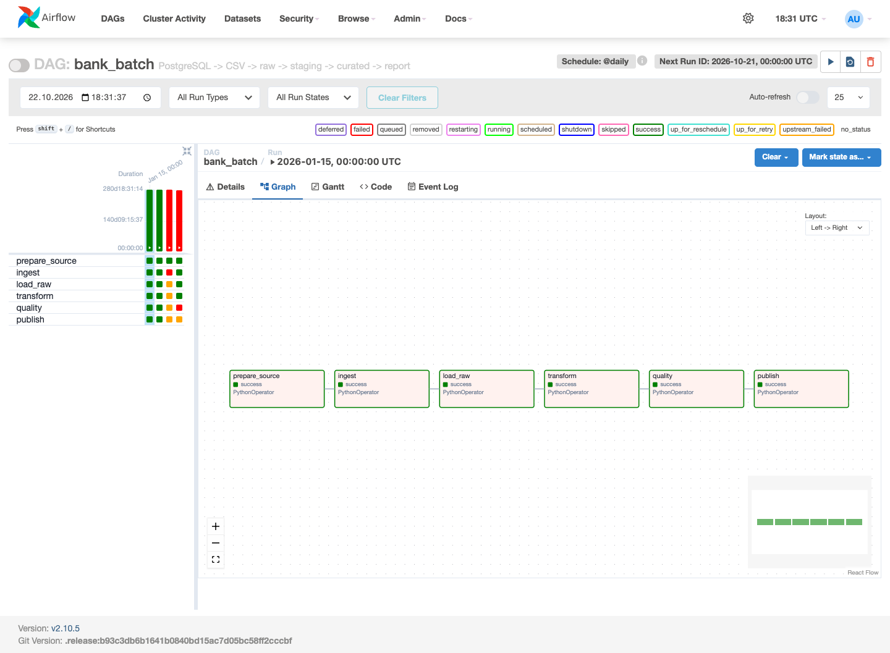
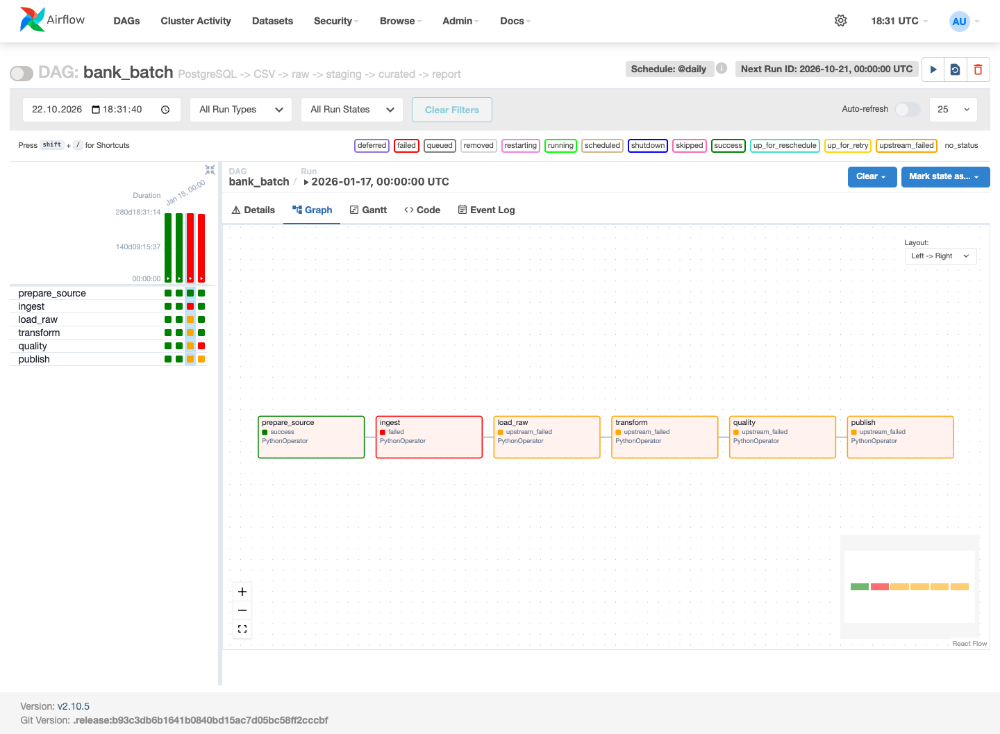

# Phase 1 Test Results

Tested on 2026-10-22 with Docker Desktop, PostgreSQL 16.4 and Airflow 2.10.5.

## Smoke test

`make smoke` passed. Run status was checked in the Airflow metadata database.

| Logical date | Source | Raw CSV | Raw table | Staging | Curated | Serving transactions | Report transactions |
|---|---:|---:|---:|---:|---:|---:|---:|
| 2026-01-15 | 1200 | 1200 | 1200 | 1200 | 1200 | 1200 | 1200 |
| 2026-01-15, repeated | 1200 | 1200 | 1200 | 1200 | 1200 | 1200 | 1200 |
| 2026-01-16 | 1200 | 1200 | 1200 | 1200 | 1200 | 1200 | 1200 |

Serving and report output contain one summary row per day for AZN, with
transaction_count=1200. Detail layers contain 1200 rows each.

Output: `SMOKE PASSED: success, repeat, two dates, all layers`.

## Failure tests

- 2026-01-17, fail_ingest=true: prepare_source succeeded, ingest failed,
  and load_raw, transform, quality and publish became upstream_failed.
- 2026-01-18, fail_quality=true: earlier tasks succeeded, quality failed,
  and publish became upstream_failed.
- Both runs finished as failed. The downstream publish status was also
  checked with an assertion against the Airflow metadata database.

## Restart test

After `docker compose down` and `docker compose up -d --wait`, both dates still
had 1200 transactions in each layer. Running 2026-01-15 again succeeded.

## Fresh setup test

Build, startup and smoke tests passed in a separate `bank-phase1-fresh`
Compose project using new volumes and `.env.example`. Host ports 5446 and 8096
were used to avoid conflicts with existing services. No manual volume
permission changes were needed.

## Code checks

Ruff lint and format checks, Python compileall and
`docker compose config --quiet` passed.

## Airflow screenshots

Successful run:

Failed ingestion with downstream tasks stopped:

## Before submission

Set up main branch protection, submit changes through focused pull requests,
check GitHub CI, and add the `phase-1` tag to the tested commit. These remote
repository steps have not been completed as part of the local tests.
